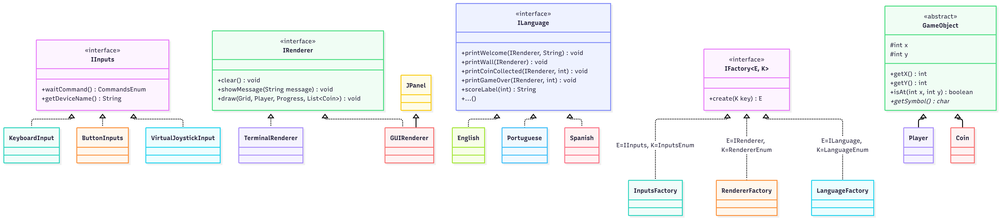

# Jogo das Moedas — versão 2: **desacoplada**

Projeto base da **Prática 03 — Coesão e Acoplamento**
Aula 08 — Design de Classes: Acoplamento e Coesão
Linguagem de Programação II — IMD/UFRN

Este é o **"depois"** — o terceiro e último passo da aula:

- `v0`: uma classe fazendo tudo → **baixa coesão**
- `v1`: quebrado em classes, mas tudo ligado no concreto → **alto acoplamento**
- **`v2` (este projeto)**: as mesmas ideias, com as dependências invertidas → **baixo acoplamento**

Na versão desacoplada, cada classe mantém uma responsabilidade clara: `Grid` representa o
cenário, `Level` executa uma fase e `MainGame` coordena a partida inteira.

> ### ⚠️ Este projeto está incompleto de propósito
>
> Três classes foram removidas. Elas serão entregues a você **uma de cada vez**, em
> `classes.zip`, ao longo dos itens 1, 2 e 3 da prática:
>
> | Classe | Item | O que ela faz |
> |---|---|---|
> | `ui/GUIRenderer.java` | 1 | Desenha o jogo numa janela gráfica (Swing) |
> | `inputs/ButtonInputs.java` | 2 | Entrada por botões clicáveis |
> | `inputs/VirtualJoystickInput.java` | 3 | Entrada por joystick simulado com o mouse |
>
> **Do jeito que está, o projeto compila e roda** — só com teclado e terminal.
> Compile e execute **antes de mexer em qualquer coisa**, para ver o ponto de partida.
>
> Copiar a classe para dentro de `src/` **não basta**: o projeto vai continuar sem
> compilar até você fazer mais duas coisas. Descobrir quais é parte do exercício.

---

## Como executar o jogo

```bash
cd jogo-das-moedas-v2
javac -d bin $(find src/main/java -name "*.java")
java -cp bin game.MainGame
```

No Windows, sem `find`, use:

```bash
dir /s /b src\main\java\*.java > sources.txt
javac -d bin @sources.txt
java -cp bin game.MainGame
```

Os cinco mapas ficam em `levels.txt`, na raiz do projeto, separados por uma
linha `---`. Use `#` para paredes, `.` para chao, `@` para o jogador e `$`
para moedas. O nível 1 é o padrão. A entrada padrão é teclado, o renderer
padrão é terminal e ambas as opções podem ser omitidas independentemente:

```bash
java -cp bin game.MainGame                       # funciona agora
java -cp bin game.MainGame -l 5                  # funciona agora
java -cp bin game.MainGame -r gui                # só depois do item 1
java -cp bin game.MainGame -i buttons            # só depois do item 2
java -cp bin game.MainGame -i joystick -r gui    # só depois do item 3
```

### Trocando entrada e saída

Esta é a demonstração principal. O **mesmo jogo** recebe opções independentes:
`-i` escolhe a entrada (`keyboard`, `buttons` ou `joystick`) e `-r` escolhe o
renderer (`terminal` ou `gui`). A opção `-l` escolhe o nível inicial.

```bash
java -cp bin game.MainGame -i keyboard -r terminal
java -cp bin game.MainGame -i keyboard -r gui
java -cp bin game.MainGame -i buttons -r terminal
java -cp bin game.MainGame -i joystick -r gui
```

Pelo Eclipse: `Run As` → `Run Configurations...` → aba `Arguments` →
escreva, por exemplo, `-i keyboard -r gui` em *Program arguments*.

O jogo pode combinar qualquer entrada com qualquer renderer. Quem junta as
peças é só o `MainGame`; a classe `Level` não muda conforme a combinação.
`InputsFactory` recebe `InputsEnum` e `RendererFactory` recebe `RendererEnum`.

As duas implementam a mesma interface genérica, que tem **dois** parâmetros de tipo —
`E` é o que se cria, `K` é a chave que decide qual criar:

```java
public interface IFactory<E, K> {
    E create(K key);
}
```

Ou seja, `InputsFactory implements IFactory<IInputs, InputsEnum>` e
`RendererFactory implements IFactory<IRenderer, RendererEnum>`.

---

## Estrutura

```
src/main/java/game/
├── MainGame.java                  ← coordena fases e escolhe implementacoes
├── Level.java                     ← regras e fluxo de uma fase
├── enums/
│   ├── CommandsEnum.java          ← comandos reconhecidos pela fase
│   ├── InputsEnum.java             ← modos de entrada
│   └── RendererEnum.java           ← modos de saída
├── inputs/
│   ├── IInputs.java               ← contrato das entradas
│   ├── InputsFactory.java          ← cria entrada conforme InputsEnum
│   ├── KeyboardInput.java         ← entrada pelo teclado
│   ├── ButtonInputs.java            ✗ AUSENTE — você adiciona no item 2
│   └── VirtualJoystickInput.java    ✗ AUSENTE — você adiciona no item 3
├── utils/
│   ├── LevelLoader.java            ← le o TXT e converte os dados da fase
│   └── IFactory.java               ← contrato generico para factories
├── ui/
│   ├── IRenderer.java             ← contrato da saída
│   ├── RendererFactory.java        ← cria saida conforme RendererEnum
│   ├── TerminalRenderer.java      ← desenha no console
│   └── GUIRenderer.java             ✗ AUSENTE — você adiciona no item 1
└── world/
   ├── Grid.java                  ← dados do cenario, dimensoes e paredes
   ├── Progress.java             ← pontuação acumulada entre missões
   └── gobjects/
      ├── GameObject.java       ← objeto do jogo
      ├── Player.java           ← posição e movimento do jogador
      └── Coin.java             ← moedas coletáveis
```

No item 5 você vai criar um pacote novo, `game/language/`, e um enum novo em
`game/enums/`. Onde exatamente cada arquivo entra é decisão sua — e você justifica
no final deste arquivo.

---

## As três ideias do projeto

### 1. Injeção de dependência

`Level` não usa `new` para nada que venha de fora. Tudo chega pelo construtor:

```java
public Level(Grid grid, Player player, Progress progress,
             List<Coin> coins, IInputs input, IRenderer renderer)
```

`MainGame` carrega cada `Grid`, monta o `Level` correspondente e preserva o
objeto `Progress` entre as fases. A fase depende das interfaces `IInputs` e
`IRenderer`, sem conhecer as implementacoes concretas. `InputsFactory` e
`RendererFactory` escolhem essas implementacoes com base em opções
independentes e implementam `IFactory<IInputs, InputsEnum>` e
`IFactory<IRenderer, RendererEnum>`, respectivamente.

`Player` representa o avatar na fase; `Progress` guarda a pontuação
cumulativa e é compartilhado pelas instâncias de `Level` criadas por `MainGame`.

### 2. Interface para contrato, classe abstrata para reúso

Duas decisões diferentes no mesmo projeto, e vale entender por quê:

| | Escolha | Motivo |
|---|---|---|
| `IInputs` | **interface** | Teclado, joystick e toque não têm **nenhum código em comum** — cada um lê de um lugar diferente. Não há nada a herdar, só um contrato a cumprir. |
| `GameObject` | **classe abstrata** | Jogador e moeda compartilham **estado real** (as coordenadas `x` e `y`) e o código que cuida dele. Só o símbolo desenhado muda — e é o único método abstrato. |

Guarde esta tabela: no item 5 você vai ter que tomar essa mesma decisão sozinho,
para os idiomas.

### 3. Polimorfismo

O método `Level.runTurn()` chama `input.waitCommand()` sem nunca perguntar
que tipo de entrada é aquela. Quem decide como responder é o objeto concreto, em tempo de execução.

---

## A comparação que resume a aula

```bash
grep -n "new \|System.out" src/main/java/game/Level.java
```

Esse comando não devolve nada. `Level` aplica **todas** as regras do jogo — colisão, coleta,
pontuação, fim de fase — sem criar um único objeto e sem imprimir uma única linha.

Rode o mesmo comando no `Game.java` da v1, mostrada em aula, e compare. Depois conte,
nos dois projetos, quantos arquivos você precisaria abrir para adicionar uma entrada nova.

Guarde esse comando: no item 5 ele vira **critério de correção**. Quando você terminar
a estratégia de idiomas, nenhum texto de mensagem pode aparecer em `Level.java`.

---
---

# ✍️ Parte a preencher pela dupla

> Tudo abaixo desta linha é sua entrega. Responda com frases curtas e diretas —
> respostas certas e longas não valem mais que respostas certas e curtas.

## Identificação

| | Nome completo | Matrícula |
|---|---|---|
| Integrante 1 | Ana Paula Evangelista Melo Freitas | 20250041027 |
| Integrante 2 | Gabriel Soares Ferreira de França | 20250055612 |

## Ambiente

- **Versão do JDK** (saída de `java -version`): openjdk 21.0.12
- **Sistema operacional**: Ubuntu 24.04
- **Comando de compilação que você usou**: `javac -d bin $(find src/main/java -name "*.java")`
- **Comando de execução que você usou**: `java -cp bin game.MainGame -i <entrada> -r <saida> -lang <idioma>`

## Itens 1 a 3 — as três classes devolvidas

**1. Preencha conforme foi fazendo:**

| Item | Classe adicionada | Quais OUTROS arquivos você precisou abrir e editar? |
|---|---|---|
| 1 | `GUIRenderer` | `RendererEnum.java` (adicionamos `GUI`) e `RendererFactory.java` (adicionamos `case GUI`) |
| 2 | `ButtonInputs` | `InputsEnum.java` (adicionamos `BUTTONS`) e `InputsFactory.java` (adicionamos `case BUTTONS`) |
| 3 | `VirtualJoystickInput` | `InputsEnum.java` (adicionamos `JOYSTICK`) e `InputsFactory.java` (adicionamos `case JOYSTICK`) |

**2.** Antes de adicionar cada classe, você rodou o jogo pedindo o modo que ainda não
existia. Qual foi a mensagem de erro, e de qual arquivo ela veio?

> **Item 1 (GUI):** A mensagem foi `Renderer must be gui or terminal: gui`, veio de `RendererEnum.from()`, em `RendererEnum.java`, pois o enum só tinha `TERMINAL`, então o `valueOf("GUI")` falhou.
>
> **Item 2 (buttons):** A mensagem foi `Mode must be buttons, joystick, or keyboard: buttons`, veio de `InputsEnum.from()`, em `InputsEnum.java`, pois o enum só tinha `KEYBOARD`, então o `valueOf("BUTTONS")` falhou.
>
> **Item 3 (joystick):** A mensagem foi `Mode must be buttons, joystick, or keyboard: joystick`, veio de `InputsEnum.from()`, em `InputsEnum.java`, pois o enum só tinha `KEYBOARD` e `BUTTONS`, então o `valueOf("JOYSTICK")` falhou.

**3.** Depois de copiar a classe para dentro de `src/`, o projeto ainda não compilava.
Qual foi o erro do compilador, e por que ele aconteceu?

> **Item 1 (GUI):** Só copiar a classe compilou, mas o `-r gui` continuou dando erro. Depois de adicionar `GUI` no enum, o javac acusou `the switch expression does not cover all possible input values` em `RendererFactory.java`, pois o switch de seta precisa ter um `case` para cada valor do enum, e faltava o `case GUI`.
>
> **Item 2 (buttons):** Só copiar a classe compilou. Depois de adicionar `BUTTONS` no enum, deu o mesmo erro do switch incompleto, agora em `InputsFactory.java`. Ao rodar o jogo depois dessa compilação que falhou, a pasta `bin/` ficou com o enum novo e a factory antiga, o que causou um `MatchException`.
>
> **Item 3 (joystick):** Só copiar a classe compilou, mas o `-i joystick` continuou dando erro. Depois de adicionar `JOYSTICK` no enum, o javac acusou `the switch expression does not cover all possible input values` em `InputsFactory.java`, pois faltava o `case JOYSTICK` no switch.

**4.** `Level.java` aparece em alguma linha da tabela do item 1? Por que isso é o
resultado esperado de um projeto com baixo acoplamento?

> Não, a `Level` não foi alterada em nenhum dos três itens. Ela só depende das interfaces `IInputs` e `IRenderer`, e não das classes concretas. Quem escolhe a implementação é o `MainGame`, através das factories, e a `Level` recebe o objeto pronto pelo construtor (injeção de dependência). Por isso, adicionar uma entrada ou uma saída nova só mexe na classe nova, no enum e na factory.

## Item 4 — pares cruzados

**5.** Rode as duas combinações e relate o que aconteceu:

| Combinação | Funcionou? | Precisou alterar alguma classe? |
|---|---|---|
| `-i buttons -r terminal` | Sim | Não |
| `-i keyboard -r gui` | Sim | Não |
| `-i joystick -r terminal` | Sim | Não |

**6.** O que essas duas execuções provam sobre a relação entre entrada e saída no projeto?

> A entrada e a saída são independentes: qualquer `IInputs` combina com qualquer `IRenderer`. Uma não conhece a outra (por exemplo, o `ButtonInputs` não sabe se a tela é o terminal ou a janela, e vice-versa). Cada uma é escolhida separadamente no `MainGame` (`-i` e `-r`), com o seu enum e a sua factory. A `Level` só fala com as interfaces, então funciona com qualquer combinação: 3 entradas × 2 saídas = 6 combinações, sem nenhum `if` para isso.

## Item 5 — a estratégia de idiomas

**7.** Liste os arquivos que você **criou**:

> - `game/enums/LanguageEnum.java`
> - `game/language/ILanguage.java`
> - `game/language/English.java`
> - `game/language/Portuguese.java`
> - `game/language/Spanish.java`
> - `game/language/LanguageFactory.java`

**8.** Liste os arquivos que você **modificou** e diga, em uma linha cada, o que mudou:

> - `Level.java`: passou a receber `ILanguage` no construtor; as 5 mensagens viraram chamadas como `language.printWall(renderer)`.
> - `MainGame.java`: ganhou a opção `-lang`, cria o idioma primeiro e o repassa às factories e à `Level`; as 2 mensagens finais viraram chamadas ao idioma.
> - `TerminalRenderer.java`: recebe `ILanguage` no construtor; o score e o prompt de comando vêm do idioma.
> - `GUIRenderer.java`: recebe `ILanguage` no construtor; o título da janela e o score vêm do idioma.
> - `RendererFactory.java`: recebe `ILanguage` no construtor e o repassa aos renderers (o contrato `IFactory` não mudou).
> - `KeyboardInput.java`, `ButtonInputs.java`, `VirtualJoystickInput.java`: recebem `ILanguage` no construtor; nomes de dispositivo, rótulos dos botões e títulos das janelas vêm do idioma.
> - `InputsFactory.java`: recebe `ILanguage` no construtor e o repassa às entradas.
>
> Nenhuma das classes protegidas (`IInputs`, `IRenderer`, `IFactory`, `Grid`, `Player` etc.) foi alterada.

**9.** `ILanguage` ficou como **interface** ou como **classe abstrata**? Justifique usando
o mesmo critério da tabela da seção "Interface para contrato, classe abstrata para reúso".

> **Interface.** Pelo critério da tabela: os três idiomas não compartilham estado nem código, só frases diferentes. Não há nada a herdar, só um contrato a cumprir, como em `IInputs`. Como visto na Aula 07, interfaces servem como contrato relacionado apenas a métodos, sem atributos (estado), que é exatamente o caso dos idiomas.
>
> Uma `abstract class Language` com um atributo `IRenderer` também traria problemas:
> 1. **Dependência circular:** os renderers precisam do idioma (para o score, o prompt e o título), e o idioma precisaria do renderer. Um teria que existir antes do outro.
> 2. **A factory não teria como passar o renderer:** `IFactory.create(K key)` recebe só a chave (`LanguageEnum`).
> 3. **As entradas também usam o idioma** (rótulos dos botões, nomes) e não têm renderer nenhum.
>
> Recebendo o renderer como parâmetro, o idioma fica sem estado e serve para qualquer renderer.

**10.** Por que os métodos de `ILanguage` recebem **dados** (como o valor do score) em vez
de receberem o texto pronto? O que aconteceria com o design se `Level` montasse a frase e
passasse a `String` para a classe de idioma?

> Porque quem monta a frase é quem conhece o idioma. Cada língua organiza a frase de um jeito ("Moeda coletada! Pontuação: 10" × "¡Moneda recogida! Puntuación: 10"), então a `Level` passa só o dado e o idioma decide onde ele entra.
>
> Se a `Level` montasse a `String`, ela voltaria a conter texto num idioma específico, e para trocar de idioma precisaria de `if/switch` por idioma dentro dela. A classe de idioma viraria só um repassador inútil, e a `Level` voltaria a ser acoplada ao idioma.

**11.** Rode `grep -n "new \|System.out" src/main/java/game/Level.java` e também procure
por texto literal entre aspas em `Level.java`. Sobrou alguma mensagem? Se sim, qual e por quê?

> O `grep` não devolve nada: a `Level` não cria objetos nem imprime. Também não sobrou nenhuma mensagem entre aspas. O único texto entre aspas no arquivo é a palavra `"new"` dentro de um comentário.
>
> Fora do pacote de idiomas, mantivemos em inglês apenas as **mensagens de exceção técnicas** (ex.: `Missing value for -lang.`, `Language must be...`, erros do `LevelLoader`). Elas não são mensagens do jogo, mas erros de uso do programa, e várias acontecem antes de o idioma ser conhecido. Além disso, o `LevelLoader` não pode ser alterado.

**12.** Quantos arquivos você precisaria modificar para adicionar um **quarto idioma**
(por exemplo, francês)? Liste-os.

> 3 arquivos, e nenhuma classe do jogo muda:
> - **criar** `game/language/French.java` (implementando `ILanguage`);
> - **modificar** `LanguageEnum.java` (adicionar `FRENCH`);
> - **modificar** `LanguageFactory.java` (adicionar `case FRENCH -> new French();`).
>
> `Level`, `MainGame`, renderers e entradas continuam iguais.

**13.** `KeyboardInput.getDeviceName()` devolve `"Keyboard"`, que aparece na tela.
Esse texto **deve** ser traduzido? Não existe resposta única aqui — defenda a sua.

> Na nossa implementação, **sim, traduzimos**. "Keyboard" não é uma marca, é um substantivo comum que aparece dentro da mensagem de boas-vindas. Deixá-lo em inglês geraria uma frase misturada, tipo "Colete as moedas - controle: Keyboard". Pelo mesmo motivo traduzimos os rótulos dos botões e os títulos das janelas. Se fosse um nome próprio de produto, não traduziríamos, porque nome de marca não muda com o idioma.

## Item 6 — diagrama UML

**14.** Com que ferramenta você fez o diagrama?

  > Mermaid (mermaid.live). O diagrama está em `diagrama-uml.png`, na raiz do projeto.
  >
  > 

**15.** Confirme: o diagrama mostra **apenas** herança (generalização) e implementação de
interface (realização), sem associações entre classes?  `[X] sim`

## Fechamento

**16.** Compare com a v1 mostrada em aula: quantos arquivos mudam lá, e quantos mudam
aqui, para adicionar uma entrada nova? O que explica a diferença?

> **Na v1**, não existia contrato de entrada: a classe `Game` tinha um `boolean useJoystick` e dois atributos concretos (`KeyboardInput keyboard` e `JoystickInput joystick`), um deles sempre `null`. A escolha do dispositivo estava espalhada em vários pontos da `Game`: no construtor (escolhe entre os dois inputs), no `readCommand()` (roteia a leitura), no `deviceName()` (pega o nome para a tela) e no `waitCommand()`. Para adicionar uma terceira entrada (ex.: mouse), seria preciso criar a classe nova e mexer em todos esses pontos da `Game`, que é a classe de regras, além do `MainGame`. E o `boolean` nem comporta um terceiro valor, então a própria estrutura teria que ser refeita.
>
> **Na v2**, são 3 arquivos: a classe nova, o `InputsEnum` e a `InputsFactory`, e a `Level` não muda. A diferença vem da inversão de dependência: a `Level` depende só do contrato `IInputs` e recebe o objeto pronto pelo construtor (injeção de dependência). Quem decide qual implementação concreta usar é o `MainGame`, via factory, num único lugar.

**17.** Alguma parte do projeto que você achou **mais acoplada do que precisava**?
Crítica honesta conta ponto — aponte o lugar e diga o que faria.

> 1. **O terminal sempre mostra "Comando (w/a/s/d, q para sair)", mesmo quando estamos usando botões ou joystick.** Essa dica só faz sentido para o teclado. Ou seja, o `TerminalRenderer` (saída) "assume" que a entrada é sempre o teclado, e isso é um acoplamento escondido entre entrada e saída.
> 2. **Com botões ou joystick no terminal, o programa não fecha sozinho.** Rodando `-i buttons -r terminal`, depois de clicar em "Sair" aparece o "Final score", mas o terminal continua travado e não aceita mais nada. Tivemos que usar Ctrl+C para encerrar. Parece que a janela dos controles continua aberta "segurando" o programa. Com `-r gui` isso não acontece, porque fechar a janela do jogo encerra tudo. Achamos que as janelas de entrada deveriam ser fechadas quando o jogo termina.
> 3. **Depois de "Wall!" ou "Unknown command." o terminal não reimprime o prompt**, e parece que o jogo travou.